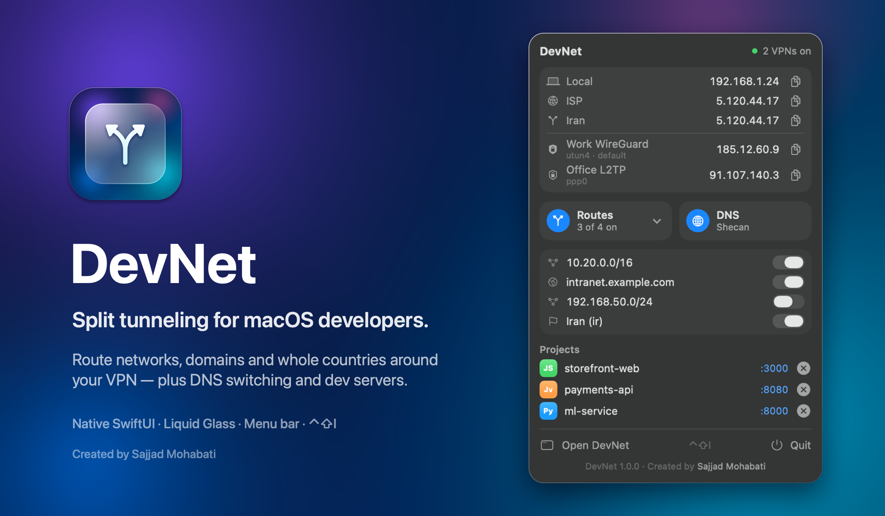

<div align="center">


# DevNet — اسپلیت تانل و عبور از VPN برای مک و لینوکس

**شبکه‌ها، دامنه‌ها و کل آی‌پی‌های ایران را از بیرون VPN رد کنید — مستقیم از منوبار مک یا سینی سیستم لینوکس.**<br>
تغییر DNS با یک کلیک (شکن، شکن حرفه‌ای، الکترو، ۴۰۳، کلادفلر…)، تست سرعت Cloudflare و مدیریت سرورهای توسعه.<br>
SwiftUI بومی در مک · GTK4 و libadwaita بومی در لینوکس · رایگان و متن‌باز · بدون حساب کاربری و بدون تلمتری

[](https://github.com/SajjadMohabati/DevNet/releases/latest/download/DevNet.dmg)
[](https://github.com/SajjadMohabati/DevNet/releases/latest)
[](https://github.com/SajjadMohabati/DevNet/releases/latest)

[](https://github.com/SajjadMohabati/DevNet/releases/latest)
[](https://github.com/SajjadMohabati/DevNet/releases)
[](LICENSE)
[](https://github.com/SajjadMohabati/DevNet/stargazers)

[English](README.md) · **فارسی** · [العربية](README.ar.md)



</div>

<div dir="rtl">

## چرا DevNet؟

VPN روشن است و حالا سامانه‌ی دانشگاه، اینترانت شرکت، درگاه بانک، سرور تست داخلی یا خیلی از سایت‌های ایرانی **باز
نمی‌شوند**: خطای ۴۰۳، تایم‌اوت، کپچا یا سرعت خیلی پایین. کلاینت VPN شما یا اسپلیت تانل ندارد، یا فقط «برای هر برنامه»
دارد، یا یک لیست ثابت که نمی‌شود عوضش کرد.

نتیجه این می‌شود که مدام `sudo route add …` یا `sudo ip route add …` را در ترمینال می‌زنید، خطای `File exists` می‌گیرید،
با عوض شدن وای‌فای همه‌چیز از بین می‌رود و هیچ‌وقت دقیق نمی‌دانید هر سایت کدام آی‌پی شما را می‌بیند.

**DevNet این مشکل را با یک کلیک حل می‌کند.** یک اپ کوچک و بومی که مجموعه‌ای از روت‌ها را روی گیت‌وی شبکه‌ی محلی، بیرون
از هر VPN، نگه می‌دارد و با عوض شدن شبکه یا VPN آن‌ها را درست نگه می‌دارد. همان امکانات و همان ظاهر، روی **مک و لینوکس**.

## امکانات

### 🔀 اسپلیت تانل که با *هر* VPN کار می‌کند
- **شبکه‌ها** (`10.20.0.0/16`)، **هاست‌ها**، **دامنه‌ها** (`samed.example.ac.ir` یا حتی یک URL کامل) و **کل آی‌پی‌های
  یک کشور** (مثلاً همه‌ی رنج‌های ایران، حدود ۱۷۰۰ رنج) از VPN عبور نمی‌کنند.
- کنار **WireGuard، OpenVPN، L2TP/IPsec، IKEv2، ProtonVPN و v2ray / Xray / sing-box در حالت TUN** کار می‌کند. DevNet
  جدول روتینگ سیستم را تغییر می‌دهد، پس برایش مهم نیست از کدام کلاینت استفاده می‌کنید یا چند VPN هم‌زمان وصل است.
- **خودترمیم:** هر روت «وضعیت دلخواه» شما را ذخیره می‌کند و DevNet جدول واقعی را با آن هماهنگ می‌کند. کلیک‌های سریع،
  تغییر شبکه و خطاهای نیمه‌کاره همه به وضعیت درست می‌رسند؛ دیگر `File exists` یا لیست نیمه‌اعمال‌شده نداریم.
- **دنبال کردن شبکه:** گیت‌وی شبکه خودکار تشخیص داده و مرتب بررسی می‌شود؛ از وای‌فای خانه به شرکت بروید، روت‌ها خودکار
  روی روتر جدید می‌روند.
- حذف هر روت دقیقاً روی همان گیت‌وی و اینترفیسی انجام می‌شود که اضافه شده بود، پس DevNet هیچ‌وقت روت VPN شما را پاک
  نمی‌کند.

### 🌐 همه‌ی آی‌پی‌ها در یک نگاه، حتی با چند VPN هم‌زمان
- **آی‌پی لوکال**، **آی‌پی واقعی اینترنت (ISP)**، آی‌پی‌ای که **سایت‌های ایرانی** می‌بینند و **برای هر VPN وصل یک خط** با
  آی‌پی عمومی و اینترفیس خودش (`utun4 · default`، `wg0`، `ppp0`…).
- کپی هر کدام با یک کلیک.

### 🧭 تغییر DNS که زیر VPN هم واقعاً اعمال می‌شود
- پریست‌های **شکن (رایگان و حرفه‌ای)، الکترو، بگذر، ۴۰۳، رادار گیم، گوگل و کلادفلر** و هر DNS دلخواه.
- بیشتر DNS چنجرها فقط DNS وای‌فای را عوض می‌کنند و در عمل به DNSای که VPN تحمیل می‌کند می‌بازند. DevNet پریست را
  **روی همه‌ی اتصال‌های فعال، از جمله VPN‌ها** اعمال می‌کند و با برگشتن به Automatic، تنظیمات اصلی را برمی‌گرداند.
- در لینوکس با **systemd-resolved**، **NetworkManager** یا فایل ساده‌ی `/etc/resolv.conf` کار می‌کند؛ هر کدام که توزیع شما
  دارد.
- نمایش DNSای که سیستم *واقعاً* استفاده می‌کند، تست سرعت هر پریست و پاک کردن کش با یک کلیک.

### ⚡️ تست سرعت و پینگ زنده
- **تست سرعت Cloudflare** با یک کلیک (دانلود، آپلود، پینگ) با نمودار زنده و تاریخچه. مسیری را می‌سنجد که ترافیک شما
  واقعاً از آن می‌رود، از VPN یا مستقیم.
- سرعت لحظه‌ای و پینگ به هدف‌های دلخواه تا وقتی DevNet باز است؛ وقتی بسته است هیچ چیزی اجرا نمی‌شود.

### 🛠 مدیریت سرورهای توسعه
- همه‌ی پروسس‌هایی که روی پورت گوش می‌دهند، بر اساس **پوشه‌ی پروژه** (Node، Bun، Deno، Python، Java/Gradle، Go، Ruby،
  PHP، .NET، Postgres، Redis، nginx…) به‌همراه **کانتینرهای Docker و Podman**.
- باز کردن در VS Code، Cursor، IntelliJ، فایل‌منیجر یا مرورگر؛ **متوقف کردن** با یک کلیک، حتی پروسس‌هایی که بعد از
  `kill` دوباره بالا می‌آیند.

### ✨ بومی در هر دو سیستم‌عامل
- **مک:** SwiftUI، پنل منوبار شبیه Control Center با **Liquid Glass**، حالت روشن و تیره، میان‌بر سراسری (**⌃⇧I**، قابل
  تغییر).
- **لینوکس:** GTK4 و libadwaita، آیکون سینی سیستم با همان پنل جمع‌وجور، حالت روشن و تیره‌ی خودکار، میان‌بر سراسری در GNOME
  و دستور `devnet --panel` برای میان‌بر در بقیه‌ی دسکتاپ‌ها.
- **کمترین دسترسی:** در مک با یک بار وارد کردن رمز یک قانون sudoers نصب می‌شود که فقط `route add/delete` و DNS را مجاز
  می‌کند؛ در لینوکس یک هلپر کوچک polkit فقط عملیات روت و DNS اعتبارسنجی‌شده را می‌پذیرد. هیچ چیز دیگری دسترسی روت نمی‌گیرد.
- سبک و سریع: بدون Electron، بدون سرویس پس‌زمینه، بدون تلمتری و بدون حساب کاربری. مصرف CPU در حالت بیکار تقریباً صفر.

## مقایسه با گزینه‌های رایج

| | اسکریپت با `route` / `ip route` | اسپلیت تانل کلاینت VPN | اپ‌های تغییر DNS | **DevNet** |
|---|:-:|:-:|:-:|:-:|
| کار با هر VPN و چند VPN هم‌زمان | ⚠️ دستی | ❌ فقط تانل خودش | — | ✅ |
| روت بر اساس دامنه / URL | ❌ | به‌ندرت | — | ✅ |
| روت کل آی‌پی‌های یک کشور با یک کلیک | ❌ | به‌ندرت | — | ✅ |
| همراهی با تغییر وای‌فای / شبکه | ❌ | ✅ | — | ✅ |
| نمایش آی‌پی ISP، ایران و هر VPN | ❌ | ❌ | ❌ | ✅ |
| غلبه‌ی DNS بر DNS تحمیلی VPN | — | — | ❌ | ✅ |
| تست سرعت روی مسیر واقعی | ❌ | ❌ | ❌ | ✅ |
| مدیریت سرور توسعه و کانتینر | ❌ | ❌ | ❌ | ✅ |
| یک اپ برای مک و لینوکس | ⚠️ | متفاوت | به‌ندرت | ✅ |
| بدون پرسیدن رمز، با کمترین دسترسی | ❌ | ✅ | ⚠️ | ✅ |
| بومی، سبک، متن‌باز و رایگان | ✅ | متفاوت | متفاوت | ✅ |

## نصب

### مک

1. **[DevNet.dmg را دانلود کنید](https://github.com/SajjadMohabati/DevNet/releases/latest/download/DevNet.dmg)**، بازش کنید
   و **DevNet** را داخل **Applications** بکشید.
2. DevNet را باز کنید. چون اپ متن‌باز است و نوتارایز نشده، بار اول macOS اجازه می‌خواهد: به
   **System Settings › Privacy & Security** بروید و **Open Anyway** را بزنید، یا در ترمینال:

</div>

```bash
xattr -dr com.apple.quarantine /Applications/DevNet.app
```

<div dir="rtl">

3. روی آیکون منوبار کلیک کنید (یا **⌃⇧I**). در پنجره‌ی DevNet یک بار **Enable Passwordless Mode** را بزنید.

پیش‌نیاز: macOS 26 Tahoe یا جدیدتر، اپل سیلیکون یا اینتل.

### لینوکس

بسته‌ی مخصوص توزیع خود را از **[آخرین نسخه](https://github.com/SajjadMohabati/DevNet/releases/latest)** دانلود کنید، بعد:

</div>

```bash
# Debian 12+ / Ubuntu 22.10+ / Linux Mint / Pop!_OS
sudo apt install ./devnet_1.3.0_all.deb

# Fedora 37+ / RHEL 9 (EPEL) / Rocky / AlmaLinux
sudo dnf install ./devnet-1.3.0-1.noarch.rpm
```

<div dir="rtl">

بعد **DevNet** را از منوی برنامه‌ها باز کنید یا دستور `devnet` را بزنید. در GNOME برای دیدن آیکون سینی سیستم، افزونه‌ی
**AppIndicator and KStatusNotifierItem Support** را فعال کنید؛ بقیه‌ی امکانات بدون آن هم کار می‌کنند.

یا نصب از سورس:

</div>

```bash
git clone https://github.com/SajjadMohabati/DevNet.git
sudo ./DevNet/linux/install.sh   # یا ./DevNet/linux/run.sh برای اجرا بدون نصب
```

<div dir="rtl">

جزئیات بسته‌بندی، رفع مشکل و مدل امنیتی در [`linux/README.fa.md`](linux/README.fa.md) آمده است.

### ساخت نسخه‌ی مک از سورس

</div>

```bash
git clone https://github.com/SajjadMohabati/DevNet.git
cd DevNet
./build.sh             # بیلد یونیورسال و نصب در /Applications
sudo ./install.sh      # اختیاری: حالت بدون رمز + هلپر DNS
./release.sh           # اختیاری: ساخت DMG
```

<div dir="rtl">

فقط **Xcode Command Line Tools** لازم است؛ بدون پروژه‌ی Xcode و بدون وابستگی.

## چطور کار می‌کند

| | مک | لینوکس |
|---|---|---|
| روت‌ها | `route(8)` از طریق گیت‌وی شبکه؛ فقط تفاوت وضعیت دلخواه و واقعی اعمال می‌شود | `ip route` از طریق هلپر polkit که هر CIDR، گیت‌وی و اینترفیس را اعتبارسنجی می‌کند |
| تشخیص VPN | `scutil --nc` و `netstat` | `ip` و NetworkManager (`nmcli`) |
| آی‌پی‌های عمومی | `curl --interface` برای هر اینترفیس | درخواست HTTPS از آدرس هر اینترفیس |
| DNS | هلپر `devnet-dns` تنظیمات DNS هر سرویس را (با نسخه‌ی پشتیبان) از طریق `scutil` می‌نویسد | `resolvectl` (systemd-resolved)، `nmcli` (NetworkManager) یا `/etc/resolv.conf` |
| دسترسی | فایل `/etc/sudoers.d/devnet` فقط برای دستورهای بالا | یک اکشن polkit فقط برای `/usr/libexec/devnet/devnet-helper` |

داده‌های شما به‌صورت JSON ساده و محلی ذخیره می‌شوند (`~/Library/Application Support/VPNRoutes/` در مک و `~/.config/devnet/`
در لینوکس).

## سؤالات رایج

**آیا DevNet یک VPN است؟** نه. DevNet تعیین می‌کند کدام ترافیک از VPN *رد نشود*. با همان VPNی که دارید استفاده‌اش کنید.

**ترافیکم نشت می‌کند؟** فقط مقصدهایی که خودتان اضافه می‌کنید از بیرون VPN می‌روند؛ بقیه داخل تانل می‌مانند.

**می‌توانم همه‌ی سایت‌های ایرانی را از بیرون VPN باز کنم؟** بله: *Add › Country IP Ranges…* و کد `ir`. این‌طوری سایت‌هایی
که آی‌پی خارجی را با ۴۰۳ رد می‌کنند (مثل سامانه‌های دانشگاه و بانک) با VPN روشن هم باز می‌شوند.

**از v2rayN / v2rayNG / Hiddify / Nekoray استفاده می‌کنم و سایت‌های ایرانی هنوز آی‌پی خارجی می‌بینند.** این کلاینت‌ها معمولاً
**پراکسی سیستم** را روشن می‌کنند و برنامه‌هایی که از پراکسی استفاده می‌کنند (از جمله مرورگر) ترافیک را مستقیم به آن
می‌فرستند؛ پس هیچ جدول روتینگی نمی‌تواند مسیرش را عوض کند. پراکسی سیستم را خاموش کنید و از **حالت TUN** استفاده کنید، یا
در کلاینت قانون `geoip:ir` → direct بگذارید. در حالت TUN روت‌های DevNet کاملاً کار می‌کنند.

**روی Wayland کار می‌کند؟** بله. نسخه‌ی لینوکس GTK4 خالص است و آیکون سینی از پروتکل استاندارد StatusNotifierItem استفاده
می‌کند (KDE، Cinnamon، XFCE، Budgie و GNOME با افزونه‌ی AppIndicator).

**حالت بدون رمز در مک چه چیزی را تغییر می‌دهد؟** فقط یک فایل sudoers که `route add/delete`،
`networksetup -setdnsservers`، پاک کردن کش DNS و هلپر DNS را مجاز می‌کند. با `sudo ./install.sh --uninstall` حذف می‌شود.

## مشارکت

Issue و Pull Request خوش‌آمد است. اگر DevNet به کارتان آمد، **⭐ به ریپو ستاره بدهید** تا بقیه هم پیدایش کنند.

## سازنده

ساخته‌شده توسط **[سجاد محبتی](https://github.com/SajjadMohabati)** · [github.com/SajjadMohabati/DevNet](https://github.com/SajjadMohabati/DevNet)

منتشر شده تحت [مجوز MIT](LICENSE). آیکون‌های نسخه‌ی لینوکس بر پایه‌ی [Lucide](https://lucide.dev) (ISC) هستند.

<sub>کلمات کلیدی: اسپلیت تانل مک و لینوکس، اسپلیت تانل اوبونتو، عبور از VPN، روت آی‌پی ایران، باز کردن سایت ایرانی با VPN روشن،
خطای ۴۰۳ با VPN، سامانه دانشگاه با VPN، استاتیک روت مک و لینوکس، DNS شکن، شکن پرو، تغییر DNS مک و لینوکس، v2ray حالت TUN،
WireGuard split tunnel، ابزار شبکه منوبار، تست سرعت، ابزار برنامه‌نویس، بستن پورت، مدیریت سرور لوکال.</sub>

</div>
